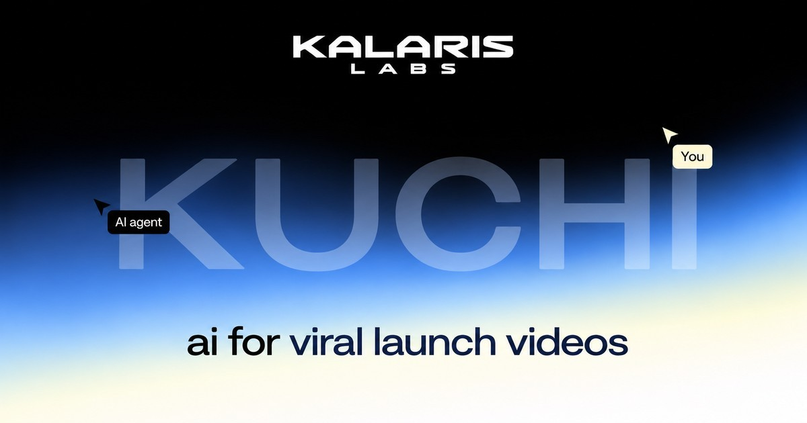

<p align="center">
  <a href="https://kuchi.kalarislabs.com/"></a>
</p>

<h1 align="center"> Kuchi</h1>

<p align="center"><b>AI for viral launch videos.</b><br>Real launch videos, measured frame by frame, that your AI agent can remake for your product.</p>

<p align="center">
  <a href="https://kuchi.kalarislabs.com/">Website</a> ·
  <a href="agent/README.md">Connect your agent</a> ·
  <a href="#the-collection">The collection</a> ·
  <a href="CONTRIBUTING.md">Contribute</a>
</p>

<p align="center">
  <a href="#the-collection"></a>
  <a href="agent/README.md"></a>
  <a href="LICENSE"></a>
  <a href="https://awesome.re"></a>
</p>

## What is Kuchi?

Kuchi is a library of launch videos that spread, built to be copied in spirit. Each one is a template: Kuchi measures its exact shots, timing and transitions, and your agent copies that motion and taste and fills it with your own product, assets and copy. It never reuses the reference's brand, footage or music.

For founders, designers and builders making their next product launch. Browse a style, watch a reference, then hand it to your agent.

Every reference has a playable video, a frame-by-frame breakdown, a remake prompt and credit to the original creator. Kuchi measures and plans; your agent does the seeing and the building. Kuchi does not render video.

## How a remake works

| Step | What happens |
| --- | --- |
| 1. Find | Describe your product. Kuchi returns a short ranked list of references, or pick one on the [website](https://kuchi.kalarislabs.com/) and paste the link. |
| 2. Study | The agent reads the reference's breakdown: every shot with its exact start, end, entrance and colors, plus storyboard frames. |
| 3. Plan | You supply your product details and assets. Kuchi returns a frame-timed blueprint for your target length. |
| 4. Build | The agent builds the video with your tools: code, motion graphics or generative video. |
| 5. Check | Kuchi flags reused brand words, borrowed assets, placeholders and timing gaps before you ship. |

## Connect your agent

Add the MCP server `https://kuchi.kalarislabs.com/mcp` (Streamable HTTP, read-only, no sign-in), or paste this into your agent:

```text
Connect the Kuchi MCP server at https://kuchi.kalarislabs.com/mcp (Streamable HTTP, no sign-in) and confirm it works by listing its tools.
```

In Claude Code, install the plugin (MCP server + skill):

```text
/plugin install kuchi --marketplace KalarisLabs/kuchi
```

[Setup for Claude, ChatGPT, Codex, Cursor & more](agent/README.md) · [Skill file](agent/SKILL.md) · [Plugin](plugin/launch-archive)

New videos reach connected agents within a minute, with no reinstall. Without MCP, the same data is at [`/agent/catalog.json`](https://kuchi.kalarislabs.com/agent/catalog.json) and [`/agent/workflow.md`](https://kuchi.kalarislabs.com/agent/workflow.md).

## What is in this repository

| Path | What it is |
| --- | --- |
| [`web/`](web) | The Kuchi website (Astro, deployed as a Cloudflare Worker) |
| [`agent-service/`](agent-service) | The MCP server and `/agent` routes |
| [`agent/`](agent) | Setup guide, the remake workflow and the agent skill |
| [`plugin/launch-archive/`](plugin/launch-archive) | The Claude Code and Codex plugin (MCP server + skill) |
| [`data/`](data) | The catalog ([`videos.json`](data/videos.json)), frame-by-frame breakdowns and daily stats |
| [`scripts/`](scripts) | Tools to add a video, analyze it, build this README and upload media |
| [`assets/`](assets) | Images used by this README |

<a id="the-collection"></a>

