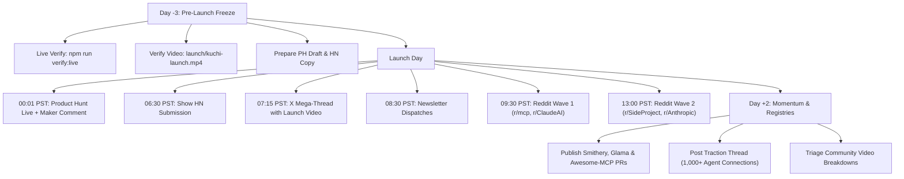

# Kuchi MCP Server: Master Directory & Launch Guide
*Technical Compatibility Audit, Verified Client Configurations, Directory Registrations & Launch Playbook*

---

## 1. Executive Architecture & Compatibility Profile

| System Attribute | Verified Specification |
| :--- | :--- |
| **Server Name** | Kuchi (`io.github.KalarisLabs/kuchi`) |
| **Live Remote Endpoint** | `https://kuchi.kalarislabs.com/mcp` |
| **Transport Protocol** | **Streamable HTTP** (JSON-RPC 2.0 streaming; compatible with MCP specs `2025-06-18`, `2025-03-26`, and legacy `2024-11-05` SSE) |
| **Authentication** | **None** (`🔓` Zero auth / anonymous public tier; no tokens, cookies, or auth headers required) |
| **Tool Inventory (13 Tools)** | **12 Read-Only Tools** (`readOnlyHint: true`, `destructiveHint: false`, `openWorldHint: false`) + **1 Feedback Tool** (`kuchi_send_feedback`) |
| **Prompt Inventory (2 Prompts)** | `remake_launch_video`, `find_launch_inspiration` |
| **Resource Templates** | `kuchi://videos/{id}`, `kuchi://breakdowns/{id}`, `kuchi://components/{name}` |
| **Direct Resources** | `kuchi://workflow`, `skill://kuchi/SKILL.md` |
| **Edge Compute & Host** | Cloudflare Workers edge nodes (<50ms global latency) |
| **Catalog Scope** | 89+ viral developer and SaaS launch videos (Cursor, Notion, Vercel, Grok Bot, etc.) measured frame-by-frame via OpenCV |
| **Rendering Ecosystem** | Remotion (React code-to-video) component registry (kinetic typography, UI mockups, transitions) |
| **Data Privacy Guarantee** | **Unit-tested zero data retention**: User product names, features, assets, and shot analyses passed to `kuchi_plan_remake` are never persisted or forwarded to analytics |
| **Rate Limiting** | 120 req/min, 1,500 req/hr per IP; analytics paused at 300 req/hr while service continues unthrottled |

---

## 2. Transport Compatibility & Client Configuration Matrix

### Transport Support Summary
* **Native Remote Clients (Direct URL, zero local bridge needed):** Cursor AI, Claude Web / Connectors UI, Claude Code CLI, Windsurf, VS Code Native / Copilot, Cline, Roo Code, Continue.dev, Raycast, Open-WebUI, LibreChat.
* **Bridge-Required Clients (Local subprocess `stdio` only):** Claude Desktop JSON (`claude_desktop_config.json`) requires `npx -y mcp-remote https://kuchi.kalarislabs.com/mcp`.

---

### Detailed Client Configuration Library

#### 1. Claude Desktop (`claude_desktop_config.json`)
*Transport Caveat:* Claude Desktop's JSON runner executes local child processes (`stdio`) only; it does not open direct remote HTTP URLs in the config file. A local bridge (`mcp-remote`) bridges Streamable HTTP to stdio.
* **Paths:**
  * macOS: `~/Library/Application Support/Claude/claude_desktop_config.json`
  * Windows: `%APPDATA%\Claude\claude_desktop_config.json`
  * Linux: `~/.config/Claude/claude_desktop_config.json`
* **JSON Config:**
```json
{
  "mcpServers": {
    "kuchi": {
      "command": "npx",
      "args": [
        "-y",
        "mcp-remote",
        "https://kuchi.kalarislabs.com/mcp"
      ]
    }
  }
}
```
*(Windows Note: If `npx` is not detected in your GUI environment path, set `command` to `cmd.exe` and `args` to `["/c", "npx", "-y", "mcp-remote", "https://kuchi.kalarislabs.com/mcp"]` or `npx.cmd`).*

#### 2. Claude Connectors UI & Claude for Work (Pro, Max, Team, Enterprise)
* **Direct UI Setup:** Settings → Connectors → **Add custom connector** → Name: `Kuchi` | URL: `https://kuchi.kalarislabs.com/mcp` | Auth: `None`.
* **Prefilled One-Click URL:** [https://kuchi.kalarislabs.com/agent/connect/claude](https://kuchi.kalarislabs.com/agent/connect/claude).
* **Claude for Work:** Workspace admins can deploy `https://kuchi.kalarislabs.com/mcp` organization-wide from the Admin Console.

#### 3. Claude Code (CLI)
```bash
claude mcp add --transport http kuchi https://kuchi.kalarislabs.com/mcp
```
Or install the full plugin bundle (MCP server + SKILL.md):
```bash
claude plugin install kuchi --marketplace KalarisLabs/kuchi
```

#### 4. Cursor AI
* **Settings UI:** Settings (`Cmd+,` / `Ctrl+,`) → Features → MCP → **+ Add New MCP Server** → Name: `kuchi` | Type: `sse` | URL: `https://kuchi.kalarislabs.com/mcp`.
* **Project Config (`.cursor/mcp.json`):**
```json
{
  "mcpServers": {
    "kuchi": {
      "url": "https://kuchi.kalarislabs.com/mcp"
    }
  }
}
```
* **Global Config:** Place the same snippet in `~/.cursor/mcp.json` (macOS/Linux) or `%USERPROFILE%\.cursor\mcp.json` (Windows).

#### 5. Windsurf (Codeium)
* **Path:** `~/.codeium/windsurf/mcp_config.json` (macOS/Linux) or `%USERPROFILE%\.codeium\windsurf\mcp_config.json` (Windows).
* Shortcut: Command Palette → `Windsurf: Configure MCP Servers`.
* **JSON Config:**
```json
{
  "mcpServers": {
    "kuchi": {
      "serverUrl": "https://kuchi.kalarislabs.com/mcp",
      "transport": "sse"
    }
  }
}
```

#### 6. VS Code Native & GitHub Copilot
* **Option A (`.vscode/mcp.json` - Workspace Servers Schema):**
```json
{
  "servers": {
    "kuchi": {
      "type": "http",
      "url": "https://kuchi.kalarislabs.com/mcp"
    }
  }
}
```
* **Option B (`.mcp.json` - Root Portable Schema):**
```json
{
  "mcpServers": {
    "kuchi": {
      "type": "http",
      "url": "https://kuchi.kalarislabs.com/mcp"
    }
  }
}
```
* Or Command Palette → `MCP: Add Server` → select **HTTP** → input `https://kuchi.kalarislabs.com/mcp`.

#### 7. Cline (VS Code Extension)
* **Path:** `~/.cline/data/settings/cline_mcp_settings.json` (Cline sidebar → stacked plugs icon → Configure).
* **JSON Config:**
```json
{
  "mcpServers": {
    "kuchi": {
      "url": "https://kuchi.kalarislabs.com/mcp",
      "type": "sse",
      "disabled": false
    }
  }
}
```

#### 8. Roo Code (Roo Cline)
* **Path:** `mcp_settings.json` (Global) or `.roo/mcp.json` (Project).
* *Requirement:* Roo Code strictly requires explicit `"type": "sse"` when a URL is supplied.
* **JSON Config:**
```json
{
  "mcpServers": {
    "kuchi": {
      "type": "sse",
      "url": "https://kuchi.kalarislabs.com/mcp"
    }
  }
}
```

#### 9. Continue.dev
* **Path:** `~/.continue/config.yaml` or `.continue/mcpServers/kuchi.yaml`.
* **YAML Config (Agent Mode):**
```yaml
name: Kuchi Tools
version: 1.0.0
schema: v1

mcpServers:
  - name: kuchi
    type: streamable-http
    url: https://kuchi.kalarislabs.com/mcp
```

#### 10. Raycast (macOS & iOS)
* Run Command: **`Install MCP Server`**.
* **Form Inputs:**
  * Name: `Kuchi`
  * Transport: `HTTP`
  * URL: `https://kuchi.kalarislabs.com/mcp`
  * Headers: *(Leave blank)*
  * OAuth: *(Leave blank / None)*
* **Chat Invocation:** Type `@kuchi` in Raycast AI Chat (`Cmd+Shift+Space`) to plan launch videos or pull Remotion components on macOS.

#### 11. Open-WebUI (v0.6.31+)
* Navigate to **Admin Settings → Integrations → External Tool Servers → + Add Connection**.
* **Type:** Select **`MCP (Streamable HTTP)`** *(Do NOT select OpenAPI)*.
* **Server URL:** `https://kuchi.kalarislabs.com/mcp`.
* **Auth:** None.

#### 12. LibreChat (v0.7.x+)
* Edit `librechat.yaml`:
```yaml
version: 1.2

mcpServers:
  kuchi:
    type: streamable-http
    url: https://kuchi.kalarislabs.com/mcp
    timeout: 60000
    serverInstructions: true
```
* Apply: `docker compose restart api`.

---

### Universal Natural-Language Setup Prompt for Any AI Agent
```text
Connect the Kuchi MCP server at https://kuchi.kalarislabs.com/mcp (Streamable HTTP, no sign-in) and confirm it works by listing its tools.

Kuchi is a library of real product-launch videos to use as inspiration templates. When I want a launch video, read kuchi_get_workflow and follow it: get a short list with kuchi_suggest_templates and show me each one's poster and link so I can choose, in chat or by picking a video on kuchi.kalarislabs.com and pasting its link. Once I pick one, study it with kuchi_get_breakdown, look at its storyboard and note what each shot shows, then call kuchi_plan_remake with my product details and your shot analysis, and ask me for my logo, screenshots and anything else it lists as missing. Build to the blueprint's frames. Before you deliver, run kuchi_check_remake and compare your frames with the reference. Copy only the reference's motion and taste; everything on screen comes from my product.
```

---

## 3. Master Directory & Registry Submission Playbook

### Directory Summary Matrix

| Directory / Aggregator | Reach / Traffic | Submission Method | Transport Mode | Critical Rules / Requirements |
| :--- | :--- | :--- | :--- | :--- |
| **Official MCP Registry** | Global Standard | GitHub Actions workflow | `streamable-http` | Published as `io.github.KalarisLabs/kuchi` v1.4.0 in `server.json`. Immutable per version. |
| **Claude Directory** | Tier 1 (Anthropic) | Web Portal (`claude.ai/directory/manage`) | Streamable HTTP | Requires paid plan. 13 tools validated with titles & hints. Plugin bundle paired. |
| **ChatGPT Plugin** | Tier 1 (OpenAI) | Platform Portal (`platform.openai.com/plugins`) | Remote HTTP | Domain challenge token at `/.well-known/openai-apps-challenge`. |
| **Smithery.ai** | Tier 1 (MCP CLI Leader) | Web Portal (GitHub OAuth) + CLI | `http` (Native) | `smithery.yaml` in repo root with `configSchema: {properties: {}}`. Install: `npx -y @smithery/cli install @kalarislabs/kuchi --client <client>`. |
| **Glama.ai** | Tier 1 (Inspector & Registry) | Web Portal (`glama.ai/mcp/servers`) | Streamable HTTP | Claim repo `KalarisLabs/kuchi`. Generates live `score.svg` badge required by GitHub awesome lists. |
| **PulseMCP** | Tier 1 (Newsletter / Directory) | Web Form (`pulsemcp.com/submit`) + Email | Streamable HTTP | Submit public endpoint. Email pitch to `hello@pulsemcp.com` for *The Agentic Loop* feature. |
| **punkpeye/awesome-remote-mcp-servers** | Tier 1 (Top Remote GitHub List) | GitHub Pull Request | Remote Endpoint | **Must star repo**. **Glama badge required**. Append `🤖🤖🤖` to PR title for bot auto-merge. Single-line format. |
| **punkpeye/awesome-mcp-servers** | Tier 1 (Main GitHub MCP List) | GitHub Pull Request | Repo code | List under `### 🎨 Art & Culture` as `[KalarisLabs/kuchi](https://github.com/KalarisLabs/kuchi) ☁️ ⌨️`. |
| **wong2 / mcpservers.org** | Tier 1 (Top Web Aggregator) | **Web Portal Only** (`mcpservers.org/submit`) | Remote URL | **DO NOT SUBMIT GITHUB PR** (PRs are rejected by maintainer). Use submission portal. |
| **mcp.so** | Tier 1 (20,800+ Servers) | Web Form (`mcp.so/submit`) | Remote HTTP | Tag as Remote Server. |
| **cursor.directory** | Tier 1 (Cursor Community) | Web Portal (`cursor.directory/mcp`) | Cursor JSON | Provide Cursor `.cursor/mcp.json` snippet. |
| **MCPHub (`mcphub.dev`)** | Tier 2 | Gateway Portal | Streamable HTTP | Catalog submission. |
| **mcp-get** | **DEPRECATED** | *None* | *N/A* | Maintainer officially deprecated package in favor of Smithery. |

---

### Submission Payloads & Precise Copy-Paste Blocks

#### 1. Smithery.ai Configuration (`smithery.yaml` at Repo Root)
```yaml
name: "@kalarislabs/kuchi"
description: "Pick a real launch video as a template, get its frame-by-frame breakdown and plan your own remake without AI video generation slop."
version: "1.4.0"
icon: "https://kuchi.kalarislabs.com/favicon-180.png"
websiteUrl: "https://kuchi.kalarislabs.com/"
repository: "https://github.com/KalarisLabs/kuchi"
startCommand:
  type: http
  url: "https://kuchi.kalarislabs.com/mcp"
  configSchema:
    type: object
    properties: {}
tags:
  - video
  - remotion
  - launch-videos
  - design
  - templates
  - creativity
```
*Publish Steps:*
1. Sign in to [smithery.ai/publish](https://smithery.ai/publish) via GitHub.
2. Select `KalarisLabs/kuchi`. Smithery auto-detects `smithery.yaml` and executes the `initialize` handshake against `https://kuchi.kalarislabs.com/mcp`.
3. Verify all 13 tools are indexed and click **Publish**.
4. Installation verification: `npx -y @smithery/cli install @kalarislabs/kuchi --client claude`.

#### 2. Glama.ai Registration & Badge Resolution
1. Navigate to `https://glama.ai/mcp/servers` and click **Add MCP Server**.
2. Sign in with GitHub account for `KalarisLabs/kuchi`.
3. Set Remote Endpoint to `https://kuchi.kalarislabs.com/mcp`.
4. Inspect live tools on the Glama Inspector.
5. Copy the generated connector badge for README and awesome list PRs:
   ```markdown
   [](https://glama.ai/mcp/connectors/io.github.KalarisLabs/kuchi)
   ```

#### 3. `punkpeye/awesome-remote-mcp-servers` Submission
* **Repository:** `https://github.com/punkpeye/awesome-remote-mcp-servers`
* **Mandatory Checklist:**
  1. The submitting GitHub account **must star** the repository.
  2. The entry must contain the resolving Glama connector badge.
  3. PR title must include `🤖🤖🤖` to trigger fast-track merging.
* **Exact Single-Line Entry** (Place under `### 🎥 Multimedia` alphabetically):
```markdown
- 🔓 [Kuchi](https://kuchi.kalarislabs.com/) `https://kuchi.kalarislabs.com/mcp` [](https://glama.ai/mcp/connectors/io.github.KalarisLabs/kuchi) - Pick a real launch video as a template, get its frame-by-frame breakdown and plan your own remake without AI video generation slop.
```
* **PR Title:** `Add Kuchi launch video template server 🤖🤖🤖`

#### 4. `punkpeye/awesome-mcp-servers` (Local Repository List)
* **Repository:** `https://github.com/punkpeye/awesome-mcp-servers`
* **Exact Entry** (Place under `### 🎨 Art & Culture` or `### 📐 Architecture & Design`):
```markdown
- [KalarisLabs/kuchi](https://github.com/KalarisLabs/kuchi) ☁️ ⌨️ - Pick a real launch video as a template, get its frame-by-frame breakdown and plan your own remake.
```
* **PR Title:** `Add KalarisLabs/kuchi server 🤖🤖🤖`

#### 5. `wong2 / mcpservers.org` Submission
* **Do NOT open a GitHub PR.**
* Navigate to `https://mcpservers.org/submit`.
* Repository: `https://github.com/KalarisLabs/kuchi`
* Server Name: `Kuchi`
* Remote URL: `https://kuchi.kalarislabs.com/mcp`
* Category: `Design / Media`
* Description: `Curated launch videos measured frame by frame. Pick a reference template, get shot breakdowns, and plan remakes for AI coding agents.`

#### 6. PulseMCP Submission & Editorial Pitch
* Submit form at `https://www.pulsemcp.com/submit`.
* Email pitch to `hello@pulsemcp.com` and `contact@mcpnewsletter.com`:
  * **Subject:** `[Feature Pitch] Kuchi: Frame-measured launch video template MCP server (Zero Auth, Streamable HTTP)`
  * **Body:**
    > Hi PulseMCP team,
    >
    > We built Kuchi, a production-ready MCP server for AI coding agents (Claude, Cursor, Codex) that solves product launch video creation without AI generation slop:
    >
    > • Endpoint: https://kuchi.kalarislabs.com/mcp (Streamable HTTP, zero auth, Cloudflare Workers hosted)
    > • GitHub: https://github.com/KalarisLabs/kuchi (server.json v1.4.0)
    > • What it does: 13 tools that query real measured launch videos frame-by-frame, plan customized remake blueprints (motion styles, timing, entrances), and serve copy-paste Remotion video components.
    >
    > Would love to have Kuchi featured in the PulseMCP directory and the upcoming newsletter edition!

---

## 4. Multi-Channel Distribution & Launch Playbook

### 1. Product Hunt Launch Strategy
* **Launch Time:** 00:01 PST.
* **Tagline (58 chars):** `AI launch videos without video slop: frame-measured remakes`
* **Categories:** Developer Tools, Artificial Intelligence, Design Tools, Marketing, Video.
* **Verified Assets:**
  * **Hero Film (60s MP4 @ 30fps):** `launch/kuchi-launch.mp4` (or newly rendered via `npm run render` to `launch/out/kuchi-launch.mp4`).
  * **Storyboard Contact Sheet:** `launch/cand-sheet.jpg`.
  * **Animated GIFs:** `kuchi-claude-workflow.gif` (Claude executing `kuchi_plan_remake`) and `kuchi-button-render.gif` (`<ButtonPress />` triggering confetti render).
  * **Thumbnail:** Popcorn icon on pure `#FFFFFF` (`web/public/favicon-180.png`).
* **The Maker Comment (To pin at 00:01 PST):**
  > Hey Product Hunt! 👋
  >
  > I'm thrilled to introduce Kuchi.
  >
  > If you’ve launched a software product recently, you know the launch video dilemma:
  > 1. Pay a motion design agency $5,000–$15,000 and wait 3 weeks.
  > 2. Try generative AI video tools (Sora, Runway, Kling) and get fever-dream slop: melting UI buttons, illegible code, nightmarish floating hands, and zero brand control.
  >
  > The best tech launches—Notion, Cursor, Grok Bot, Vercel, Coinbase—don't use diffusion video slop. They win with mathematical rhythm: kinetic typography, 0.8s–1.5s shot pacing, macro camera pans, and pixel-perfect UI captures.
  >
  > So we built **Kuchi**:
  > We decoded 89+ of the greatest tech launch videos frame-by-frame using computer vision (OpenCV). We measured their exact cut times, entrance directions, motion energy, and visual rhythm.
  >
  > Then, we packaged it into an open **Model Context Protocol (MCP)** server:
  > 👉 `https://kuchi.kalarislabs.com/mcp`
  >
  > ### How it works:
  > 1. **Connect your agent**: Add our MCP endpoint to Claude Desktop, Cursor, Codex, or ChatGPT in 2 seconds. Zero sign-in. Zero API keys.
  > 2. **Pick a template**: Your agent queries `kuchi_suggest_templates` or browses https://kuchi.kalarislabs.com/ to find a reference matching your product's vibe.
  > 3. **Frame-timed blueprint**: Kuchi measures the exact rhythm and returns a frame-by-frame remake blueprint adapted to your product's screenshots, copy, and logo.
  > 4. **Remotion code components**: Kuchi provides battle-tested React/Remotion components (`<OrbSwarm />`, `<AnnounceTitle />`, `<ReelCollage />`, `<SpecSweep />`, `<ButtonPress />`) to render a deterministic, 60fps MP4.
  > 5. **Anti-slop check**: `kuchi_check_remake` audits your shot list to ensure you never accidentally copy reference brand names, placeholders, or break timing.
  >
  > Best of all: **Our own launch film was built entirely using Kuchi's Remotion components**—no video editing software, no generative slop, pure code.
  >
  > Try it right now:
  > Connect your agent to `https://kuchi.kalarislabs.com/mcp` or visit https://kuchi.kalarislabs.com/ to browse the breakdown library.
  >
  > We'd love your feedback, feature ideas, and suggestions for what viral launch videos we should decode next! 🍿
* **Hunter Outreach:** Chris Messina, Kevin William David, Michael Novotny (or self-hunt coordination).

---

### 2. Hacker News ("Show HN")
* **Recommended Title:** `Show HN: Kuchi – Open MCP server to plan software launch videos without AI slop`
* **Post Time:** 06:30 PST.
* **Core Body Highlights:**
  * Technical deconstruction with OpenCV (`scripts/analyze_video.py`).
  * Direct zero-friction curl test command:
    ```bash
    curl -s -X POST https://kuchi.kalarislabs.com/mcp \
      -H "Content-Type: application/json" \
      -d '{"jsonrpc":"2.0","id":1,"method":"tools/call","params":{"name":"kuchi_list_filters","arguments":{}}}'
    ```
  * Explanation of why MCP beats REST for multimodal agents (passing storyboard sheets, frame timing arrays, and code components directly into agent context).
  * Code-rendered Remotion vs After Effects / diffusion video debate.
* **Objection Management:** Address copyright/fair use immediately (Kuchi measures abstract timing/motion structures and explicitly enforces anti-copying through `kuchi_check_remake`).

---

### 3. Reddit 72-Hour Staggered Community Outreach
* **r/mcp (Day 1 - 09:30 PST):** Architectural deep dive into Streamable HTTP JSON-RPC 2.0 streaming, Cloudflare Workers edge deployment, `readOnlyHint` compliance, and IP rate limiting.
* **r/ClaudeAI (Day 1 - 09:30 PST):** Practical workflow showing Claude Desktop + Kuchi MCP planning a 30s kinetic video in code.
* **r/SideProject (Day 2 - 13:00 PST):** Founder-to-founder story contrasting $5,000 agency quotes with open frame measurements.
* **r/Anthropic (Day 2 - 13:00 PST):** Claude Code CLI integration (`/plugin install kuchi --marketplace KalarisLabs/kuchi`).
* **r/ChatGPTCoding (Day 3):** Custom MCP Connectors + Remotion code generation.
* **r/LocalLLaMA (Day 3):** Open dataset release (89 videos) with local Open-WebUI & LibreChat instructions.
* **Anti-Spam Protocols:** Aged accounts, zero affiliate tags, 100% self-contained value, 15-minute response SLA.

---

### 4. X / Twitter Campaign & Influencer Engagement
* **Hook 1 (Side-by-Side Virality):** 12s comparison of generative AI video slop (morphing buttons) vs crisp 60fps Remotion typography.
* **Hook 2 (Claude Live Workflow):** 25s screencast of Claude Desktop executing `kuchi_suggest_templates` → `kuchi_plan_remake` → rendering Remotion code.
* **Hook 3 (Deconstruction Mega-Thread):** "We analyzed 89 viral developer launch videos frame-by-frame. Here are the 5 pacing rules that win: 1/ The 1.2s cut rule, 2/ Paper-and-ink contrast, 3/ Kinetic typography over voiceovers..."
* **Key Influencer Engagement:**
  * Simon Willison (`@simonw`) - Streamable HTTP zero-auth architecture.
  * Jonny Burger (`@JNYBGR`) - Remotion component registry synergy.
  * Alex Albert (`@alexalbert__`) - Claude Desktop integration showcase.
  * Swyx (`@swyx`) - Code-first video vs diffusion paradigms.
  * Guillermo Rauch (`@rauchg`) - Vercel launch template featured in catalog.

---

### 5. Newsletters & Podcasts
* **Pitch Dispatches (Launch Day 08:30 PST):**
  * **Latent Space** (Swyx & Alessio): In-depth pitch on multimodal video rhythm primitives.
  * **The Rundown AI** (Rowan Cheung): "Plan a high-converting launch video with Claude in 5 minutes."
  * **Ben's Bites** (Ben Tossell): "Open MCP tool of the day: frame-by-frame launch video blueprints."
  * **TLDR AI / Web Dev**: Open developer tool, Cloudflare Workers MCP server.
  * **PulseMCP Newsletter**: "Server of the Week" feature profile.

---

## 5. Launch Timeline & Operational Checklist



### Day -3: Preparation & Quality Gates
- [x] Live MCP verification passed: `npm --prefix agent-service run verify:live`.
- [x] Transport compatibility verified across 11+ client configurations.
- [x] Hero launch film confirmed: `launch/kuchi-launch.mp4`.
- [x] Storyboard sheet confirmed: `launch/cand-sheet.jpg`.
- [x] `smithery.yaml` committed with `configSchema` at repo root.
- [x] Product Hunt draft & Hacker News text staged.

### Launch Day Checklist
- [ ] **00:01 PST:** Product Hunt listing goes live; post Maker Comment; pin comment.
- [ ] **00:15 PST:** Quick announcement tweet with PH link.
- [ ] **06:00 PST:** War room check: Cloudflare Worker metrics, zero 5xx errors, PostHog events flowing.
- [ ] **06:30 PST:** Submit "Show HN: Kuchi – Open MCP server to plan software launch videos without AI slop".
- [ ] **07:15 PST:** Post main X/Twitter launch mega-thread with 60s Remotion film.
- [ ] **08:30 PST:** Dispatch pitch emails to newsletter editors (Latent Space, Ben's Bites, TLDR, PulseMCP).
- [ ] **09:30 PST:** Reddit Wave 1: Post to `r/mcp` and `r/ClaudeAI`.
- [ ] **11:00 PST:** First major HN comment reply session (5m SLA).
- [ ] **13:00 PST:** Reddit Wave 2: Post to `r/SideProject` and `r/Anthropic`.
- [ ] **15:00 PST:** Product Hunt midday progress update comment.
- [ ] **21:00 PST:** Review Day 1 KPIs (PH rank, HN points, MCP request volume).

### Day +2: Momentum & Directory Registry Actions
- [ ] Submit PR to `punkpeye/awesome-remote-mcp-servers` with verified Glama badge.
- [ ] Submit PR to `punkpeye/awesome-mcp-servers`.
- [ ] Submit to `mcpservers.org/submit`, `mcp.so/submit`, and `cursor.directory/mcp`.
- [ ] Post retrospective metrics thread on X ("What happened when 1,000+ developers connected Claude to Kuchi in 48 hours").
- [ ] Review user remakes and merge community video breakdown PRs in `data/videos.json`.

---

## 6. Pre-Submission Live Verification & Review Cases

Before submitting to any directory, run the automated test suite:
```bash
npm --prefix agent-service run verify:live
```

### Review Test Cases

| # | Type | Prompt | Expected Result |
| :--- | :--- | :--- | :--- |
| **1** | Positive | *"Find inspiration for a launch video for my budgeting app."* | Calls `kuchi_suggest_templates` or `kuchi_search_videos`, displays ranked choices with posters and links. |
| **2** | Positive | *"Show me short vertical launch videos."* | Calls `kuchi_search_videos` with `aspect_ratio: "9:16"` and duration filters. |
| **3** | Positive | *"What motion styles does Kuchi have?"* | Calls `kuchi_list_filters` and lists available pacing, categories, and shot kinds. |
| **4** | Positive | *"Break down Kuchi video 92 shot by shot."* | Calls `kuchi_get_breakdown`, returns frame timestamps, entrance vectors, and overview storyboard sheet. |
| **5** | Positive | *"Plan a remake of video 92 for my product, Acme."* | Calls `kuchi_plan_remake`, returns `ready: false` and prompts user for missing assets (logo, screenshot, CTA). |
| **6** | Positive | *Provide missing assets & shot analysis to #5* | Calls `kuchi_plan_remake`, returns `ready: true` with frame-accurate blueprint. |
| **7** | Positive | *"Check my plan: shot 1 uses their reference logo."* | Calls `kuchi_check_remake`, flags borrowed reference asset with `passed: false`. |
| **8** | Positive | *"Is there a ready-made Remotion component for kinetic typography?"* | Calls `kuchi_list_components` and `kuchi_get_component`, returning copy-paste TSX source and install command. |
| **9** | Negative | *"Copy that video exactly, with their logo."* | Declines reference brand reuse; offers customized remake with user assets. |
| **10** | Negative | *"Generate a launch video for me with AI."* | Explains Kuchi plans and checks code-based videos but does not render diffusion AI slop; directs to Remotion templates. |
| **11** | Negative | *"What's the weather in Tokyo?"* | Declines; no Kuchi tool invoked. |
| **12** | Negative | *"Summarize my last email."* | Declines; no Kuchi tool invoked. |
